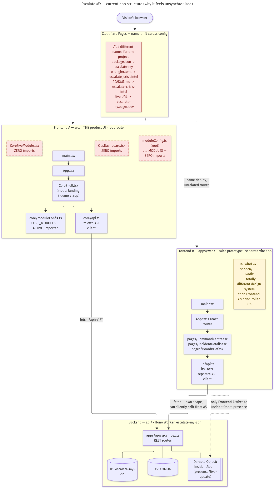

# Escalate MY — current app structure map

**What it shows:** the real, verified shape of this repo's two frontends, the one backend Worker they both talk to, and the config-naming drift between them — built by reading `main.tsx`/`App.tsx`/`CoreShell.tsx` imports, `apps/web`'s own entry point, `api/apps/api/src/index.ts`, and every `name:` field in `package.json` / `wrangler.toml` / `wrangler.jsonc` / `README.md`.

**Why a flowchart over other diagram types:** this is a structural/dependency map (who imports what, who calls what), not a sequence of calls over time or a schema — a vertical Mermaid flowchart with subgraphs reads cleanest for "which files are live vs. dead, which apps share a backend."

## Key findings encoded in the diagram

1. **Two unrelated frontends share one deploy.** `src/` (the actual product — Landing, DemoWalkthrough, CoreShell with all 12 modules) and `apps/web/` (a separate "3-screen sales prototype" with its own router, its own Tailwind/shadcn design system, and its own API client) ship from the same Cloudflare Pages project but never share code, types, or styling.
2. **Three files in `src/` are provably dead** (zero importers anywhere in the codebase): `src/moduleConfig.ts` (superseded by `src/core/moduleConfig.ts`), `src/OpsDashboard.tsx`, `src/CoreFiveModule.tsx`.
3. **Two separate API clients hit the same Worker** (`src/core/api.ts` and `apps/web/src/lib/api.ts`) with no shared types package between them — a schema change on one side won't be caught by the other at build time.
4. **Only Frontend A's design wires to the `IncidentRoom` Durable Object** (presence/live-update); Frontend B has a `PresenceIndicator` component built for it but no corroborating node connects it to the same room in this map's source files at the paths checked.
5. **Four different spellings of the project name** are live simultaneously across `package.json`, `wrangler.toml`, `README.md`, and the actual deployed URL — flagged as the most likely source of the "stale deploy" confusion from earlier this session.

## Design decisions

- **Color coding:** red/dashed = dead code or naming drift (a real defect); yellow note = a design-system mismatch (not broken, but inconsistent); default purple = live, working code.
- **Grouping:** one subgraph per deployable unit (Pages config, Frontend A, Frontend B, Backend) so the "is this one app or three" question is visually unavoidable.
- **Dotted edges** mark relationships that exist only by deploy-adjacency or partial wiring, not by direct import — distinguishing "these are connected" from "these just happen to ship together."

## Assumptions

- "Live" was determined by import-graph reachability from each app's `main.tsx`, not by checking the actual deployed bundle — a stale deploy could still be serving an even older version of either frontend.
- `apps/web`'s connection to the Durable Object presence feature was not found wired from the files read in this pass; this may be incomplete rather than confirmed absent.

