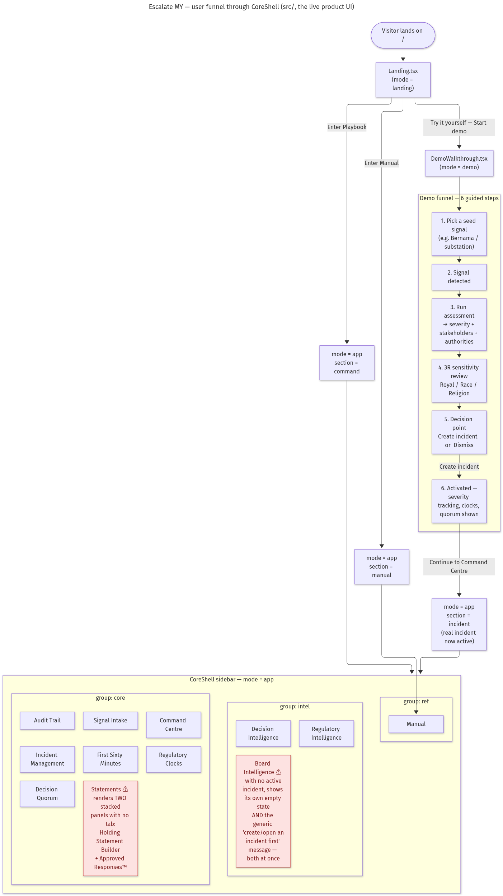

# Escalate MY — user funnel (CoreShell, the live product UI)

**What it shows:** the actual click-through path a visitor takes through `src/CoreShell.tsx` — from landing, through the guided demo, into the full app shell's three nav groups — traced directly from `CoreShell`'s `mode`/`section` state machine and its conditional render blocks.

**Why a flowchart over other diagram types:** this is a step-by-step user journey with branches (3 landing CTAs, a 6-step demo, a decision point), which is exactly what a vertical Mermaid flowchart is for — a state diagram would suit the `mode` transitions alone but would lose the nav-group structure, which matters just as much here.

## Key findings encoded in the diagram

1. **The funnel itself is coherent** — Landing → Demo (6 steps) → Command Centre, and Landing → Playbook/Manual directly, both check out against the code with no dead ends.
2. **"Statements" renders two unrelated panels stacked with no tab or toggle** (`Holding Statement Builder` and `Approved Responses™` both render whenever `section === 'statements'`, back to back in `CoreShell.tsx` lines ~476–618) — a real UX inconsistency, not a design choice signposted anywhere.
3. **"Board Intelligence" shows a duplicate empty state.** When no incident is active, `BoardIntelligence` renders its own empty-state copy, *and* `CoreShell`'s generic fallback (`"Create or open an incident first"`) also renders underneath it, because `'board-intel'` was left out of the exclusion list that fallback checks. Two conflicting empty-state messages stacked on one screen.

## Design decisions

- **Color coding:** red = a confirmed UI defect (duplicate render), purple = normal flow.
- **The demo funnel is boxed as its own subgraph** since it's a self-contained mini-funnel with its own linear steps before rejoining the main app.
- **Sidebar groups (`core` / `intel` / `ref`) are kept as separate subgraphs** to mirror how `CoreShell.tsx` actually partitions `CORE_MODULES` for rendering three nav pillars.

## Assumptions

- This traces only the `src/` product UI (Frontend A). `apps/web/`'s separate router-based funnel (`/`, `/incident/:id`, `/board-brief`) is a different, disconnected funnel — see `app-structure-map.md`.
- Button copy shown in diagram labels is condensed from the actual JSX for space; see `CoreShell.tsx` / `Landing.tsx` / `DemoWalkthrough.tsx` for exact strings.

